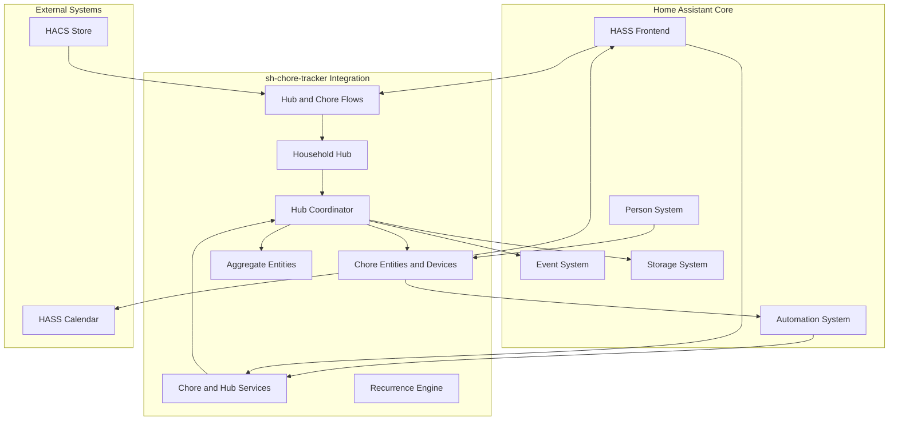

# HASS sh-chore-tracker Integration Architecture Document

## 🚀 PRIMARY NFR: DEBUGGING-FIRST ARCHITECTURE

> **CRITICAL REQUIREMENT**: This integration is architected with debugging as the primary non-functional requirement. All development workflows, repository structure, and deployment patterns prioritize full debugging capabilities.

### Debugging Architecture Principles:

- **Breakpoint Debugging**: 100% support for VS Code breakpoints in source code during HASS execution
- **Variable Inspection**: Real-time access to all integration state (coordinator data, entity attributes, service parameters)
- **Hot Code Reloading**: Symlink-based architecture allows immediate testing of code changes
- **Safety-First**: Repository isolation prevents accidental commits to Home Assistant core
- **Integration Testing**: All functionality (config flows, services, entities) debuggable through HASS UI

## Introduction

This document outlines the overall project architecture for HASS sh-chore-tracker Integration, including backend systems, shared services, and non-UI specific concerns. Its primary goal is to serve as the guiding architectural blueprint for AI-driven development, ensuring consistency and adherence to chosen patterns and technologies while maintaining debugging-first development capabilities.

**Relationship to Frontend Architecture:**
This integration leverages Home Assistant's native frontend framework, so no separate Frontend Architecture Document is needed. All UI components use HASS's built-in Material Design system and theming capabilities.

### Starter Template or Existing Project

**N/A** - This is a greenfield HASS custom integration built from scratch following Home Assistant's integration development patterns and cookiecutter template structure.

### Change Log

| Date       | Version | Description                                                                                                    | Author                    |
| ---------- | ------- | -------------------------------------------------------------------------------------------------------------- | ------------------------- |
| 2025-10-07 | v1.0    | Initial architecture document creation                                                                         | Winston (Architect)       |
| 2026-01-05 | v1.1    | Updated for implementation completion - Helper integration, RecurrenceEngine, DateCalculator, service handlers | Repository Analysis Agent |

## High Level Architecture

### Technical Summary

The HASS sh-chore-tracker Integration follows Home Assistant's custom integration architecture pattern, implementing a native Python integration with entity coordinator state management. The system uses HASS's built-in storage APIs for persistence, entity framework for state representation, and config flow for user configuration. Core architectural patterns include the coordinator pattern for efficient state updates, service-based actions for chore management, and event-driven automation integration that aligns with HASS's reactive automation ecosystem.

### High Level Overview

**Architecture Style:** Single household hub with native chore subentries

- **Repository Structure:** Monorepo following HASS integration standards
- **Service Architecture:** One hub config entry owns chore subentries, chore devices, and household aggregate entities
- **Integration Pattern:** Hub `ConfigFlow` creates the first chore; `ConfigSubentryFlow` adds and edits chores
- **Runtime Ownership:** One `DataUpdateCoordinator` manages chore state and one Store record persists it by stable chore ID
- **Data Flow:** User configures hub/chore -> Hub coordinator evaluates lifecycle -> Entities expose state -> Automations react

**Key Architectural Decisions:**

1. **Hub Integration:** One singleton household config entry owns all chore subentries.
2. **Guided Chore Flow:** The recurrence branch determines which schedule fields are shown.
3. **Single Coordinator:** One hub coordinator manages all chore lifecycle state.
4. **Stable Chore Identity:** The subentry unique ID keys each entity, device, and persisted state record.
5. **Home Assistant Storage:** One versioned Store map persists mutable lifecycle state.
6. **Household Aggregates:** Hub sensors expose nearest due date, overdue count, and any-overdue status.
7. **All-Day Event Model:** Recurrence calculations use local calendar dates.

### High Level Project Diagram



## Technology Stack

### Core Technologies

- **Language:** Python 3.11+
- **Framework:** Home Assistant Integration Framework
- **Testing:** pytest with HASS testing utilities
- **Package Management:** Home Assistant dependency management
- **Distribution:** HACS (Home Assistant Community Store)

### Home Assistant Dependencies

- **homeassistant.core:** Core HASS framework and entity system
- **homeassistant.config_entries:** Config flow and integration setup
- **homeassistant.helpers:** Entity coordinator, storage helpers, event helpers
- **homeassistant.components.calendar:** Calendar integration (Phase 2)
- **homeassistant.components.person:** Person entity integration

### Development Dependencies

- **pytest-homeassistant-custom-component:** Testing framework
- **black:** Code formatting
- **pylint:** Code linting
- **mypy:** Type checking
- **pre-commit:** Git hooks for code quality

### External Libraries

- **Runtime third-party dependencies:** None currently declared in `manifest.json` requirements
- **Potential future dependencies (not currently required):**
  - `python-dateutil` for expanded date/time utilities
  - `croniter` for cron-like schedule expressions
  - `pytz` if explicit timezone library behavior is needed beyond HA utilities

## System Architecture

### Integration Structure

```
custom_components/
└── sh_chore_tracker/
    ├── __init__.py              # Hub migration, coordinator, lifecycle and service setup
    ├── manifest.json            # Integration metadata
    ├── config_flow.py          # Hub ConfigFlow and chore ConfigSubentryFlow
    ├── const.py                # Constants and configuration keys (~70 lines)
    ├── date_utils.py           # DateCalculator utility for date arithmetic (~134 lines)
    ├── sensor.py               # Chore and household aggregate sensors
    ├── button.py               # Per-chore complete, snooze, skip and reset controls
    ├── brand/                  # Local Smart Hass icon assets
    ├── services.yaml           # Service definitions (~100 lines)
    ├── strings.json            # UI translations (~80 lines)
    └── translations/
        └── en.json             # English translations
```

### Core Components

#### 1. Integration Entry Point (`__init__.py`)

- **Responsibility:** Integration lifecycle management, service registration, platform loading
- **Key Functions:** `async_setup_entry()`, `async_unload_entry()`, `async_migrate_entry()`, service handlers
- **Coordinator Management:** Initializes one ChoreCoordinator for the hub and all chore subentries
- **Service Registration:** Registers seven chore actions plus hub `create_chore` and response-only `list_my_chores`
- **Event System:** Fires events for all state transitions
- **Entry Migration:** Integration setup imports helper-era and device-per-chore entries as subentries before removing old entries

#### 2. Configuration Flow (`config_flow.py`)

- **Responsibility:** User-facing setup and configuration management via a branching, multi-step flow
- **Features:** `basic_info` → `recurrence_type` → recurrence-specific step(s) → `first_occurrence`; only fields relevant to the chosen recurrence type are shown at each step
- **UI Components:** Selector-based interface (SelectSelector, NumberSelector, etc.)
- **Validation:** Per-step validation (weekly days required, monthly ordinal/weekday validity, first-occurrence date checks)
- **Subentry Flow:** `ChoreTrackerChoreSubentryFlow` mirrors the create steps and updates chore subentry data

#### 3. DateCalculator Utility (`date_utils.py`)

- **Responsibility:** Smart date arithmetic for recurrence calculations
- **Methods:** Add days/weeks/months, handle month-end overflow, leap year handling
- **Edge Cases:** Empty lists, invalid units, calendar date validation
- **Test Coverage:** 22/22 tests passing

#### 4. Chore Entity (`sensor.py`)

- **Type:** Sensor entity with comprehensive attributes
- **State Representation:** 5 states (pending, complete, overdue, snoozed, skipped)
- **Attributes:** 15+ attributes for automation (next_due_date, assigned_to, completion_count, etc.)
- **Device Class:** Custom sensor for chore tracking
- **Unique ID:** Stable entity identification based on config entry

#### 5. RecurrenceEngine (`__init__.py`)

- **Responsibility:** Complex recurrence pattern calculation
- **Pattern Types:** INTERVAL, WEEKLY, MONTHLY, YEARLY (4 total)
- **Algorithm:** Strategy pattern with functional composition
- **Edge Cases:** Month-end overflow, leap years, strict calendar dates
- **Test Coverage:** 25/25 tests passing

### Data Model

#### Chore Configuration Schema

```python
# Static configuration stored in ConfigSubentry.data
{
  "chore_name": str,
  "chore_description": str,
  "assigned_person": str,                # Person entity_id or "none"
  "recurrence_type": str,                # interval/weekly/monthly/yearly
  "pattern_interval": int,
  "interval_unit": str,
  "weekly_days": list[str],
  "monthly_mode": str,
  "monthly_day": int,
  "monthly_ordinal": str,
  "monthly_weekday": str,
  "yearly_month": int,
  "yearly_day": int,
  "first_occurrence_date": str,
}
```

#### Entity State & Attributes

```python
# Entity lifecycle status values
STATE_PENDING = "pending"      # Chore is due or upcoming
STATE_DUE = "due"              # Due today
STATE_COMPLETE = "complete"    # Chore has been completed
STATE_OVERDUE = "overdue"      # Past due date without completion
STATE_SNOOZED = "snoozed"      # Temporarily postponed
STATE_SKIPPED = "skipped"      # Current occurrence skipped

# Entity attributes (15+ total)
{
    # Core attributes
    "chore_name": str,
    "description": str,
    "assigned_to": str,
    "recurrence_pattern": str,
    "pattern_interval": int,
    "interval_unit": str,
    "next_due_date": date,
    "last_completed": datetime,
    "completion_count": int,
    "days_until_due": int,
    "status": str,

    # Snooze metadata
    "snooze_until": date,
    "snooze_reason": str,
    "snooze_count": int,

    # Skip metadata
    "original_due_date": date,
    "skip_reason": str,
    "skip_count": int,
    "skipped_at": datetime,

    # Pattern-specific
    "weekly_days": list,
    "monthly_day": int,
}
```

    enabled: bool = True             # Enable/disable chore
    created_at: datetime
    updated_at: datetime

@dataclass
class RecurrencePattern:
type: str # interval/weekly/monthly/yearly
pattern_interval: Optional[int] # Frequency multiplier
interval_unit: Optional[str] # days/weeks/months (for interval type)
weekly_days: Optional[str] # Comma-separated days (for weekly type)
monthly_day: Optional[int] # Day of month (for monthly/yearly type)
start_date: datetime # Pattern start reference

@dataclass
class ChoreState:
status: ChoreStatus # PENDING, COMPLETE, OVERDUE, SNOOZED
next_due_date: datetime
last_completed_date: Optional[datetime]
completion_count: int
snooze_until: Optional[datetime]
days_until_due: int # Computed property

````

#### Proposed Date-Only Lifecycle Model (vNext)

This model treats chores as all-day calendar tasks and evaluates lifecycle transitions using local **date-only** comparisons, not full timestamps.

Core policy:

1. A chore due on a given date has the full window from 00:00 to 23:59 local time.
2. Overdue starts only after day rollover.
3. Completion, skip, and snooze recalculate due dates but state transitions are still date-driven.

State set (proposed):

- `due`: explicitly due today and actionable now
- `pending`: scheduled for a future date
- `complete`: completed for current occurrence until next due date is reached
- `overdue`: due date is before today and no resolving action was taken
- `skipped`: current occurrence skipped, persists until next occurrence date
- `snoozed`: temporarily deferred, persists until snooze target date

Date-only guard rules:

1. If `next_due_date == today` and status is open, status is `due`.
2. If `next_due_date < today` and status is open, status is `overdue`.
3. If `next_due_date > today` and status is open, status is `pending`.

Open status means status is not `complete`.

```mermaid
stateDiagram-v2
  [*] --> Pending

  Pending --> Due: day_rollover && next_due_date == today
  Due --> Overdue: day_rollover && next_due_date < today

  Due --> Complete: complete_chore
  Overdue --> Complete: complete_chore

  Due --> Snoozed: snooze_chore
  Overdue --> Snoozed: snooze_chore

  Due --> Skipped: skip_chore
  Overdue --> Skipped: skip_chore

  Skipped --> Due: day_rollover && next_due_date == today
  Skipped --> Pending: day_rollover && next_due_date > today

  Snoozed --> Due: day_rollover && snooze_until == today
  Snoozed --> Pending: day_rollover && snooze_until > today

  Complete --> Due: day_rollover && next_due_date == today
  Complete --> Pending: day_rollover && next_due_date > today

  Skipped --> Due: restore_chore && next_due_date == today
  Skipped --> Pending: restore_chore && next_due_date > today
````

Scenario alignment with expected behavior:

1. Daily chore due today remains `due` all day, not `overdue`.
2. Complete today -> next due tomorrow -> status moves from `complete` to `due` at tomorrow rollover.
3. If not completed on due date, status becomes `overdue` on next day.
4. Skip due today -> status remains `skipped` until next occurrence date, then transitions to `due` or `pending`.
5. Snooze -> status remains `snoozed` until snooze date, then transitions to `due` or `pending`.

Coordinator cadence note:

1. Lifecycle evaluations run on the coordinator refresh interval (`UPDATE_INTERVAL`) rather than an exact midnight callback.
2. Complete and skipped states queue to `pending` after calendar day rollover when their `next_due_date` is still in the future.

Automation compatibility note:

Automations should use the explicit `due` state for chores due today; `pending` represents a future chore.

Event emission decision:

1. Implement `sh_chore_tracker_chore_overdue` event on transition into `overdue` only.
2. Do not emit repeated overdue events on subsequent coordinator refreshes while already overdue.
3. No separate due event is emitted; state triggers cover due-today automation.

#### Storage Structure

```json
{
  "chores": {
    "stable_chore_id": {
      "status": "pending",
      "next_due_date": "2026-10-10T00:00:00+00:00",
      "last_completed_date": null,
      "completion_count": 0,
      "snooze_until": null,
      "skip_reason": null
    }
  }
}
```

Static chore configuration is stored in `ConfigSubentry.data`; the hub Store contains only mutable per-chore lifecycle state keyed by stable chore ID.

### Service Architecture

#### Implemented Services

1. **complete_chore**
   - **Parameters:** `entity_id` (required)
   - **Logic:** Mark chore complete, auto-calculate next due date using RecurrenceEngine
   - **State Transition:** Any → complete
   - **Events:** Fires `chore_completed` with next_due_date
   - **Attributes Updated:** last_completed, completion_count, next_due_date

2. **snooze_chore**
   - **Parameters:** `entity_id` (required), `days` (required), `reason` (optional)
   - **Logic:** Postpone chore for specified days
   - **State Transition:** Any → snoozed
   - **Events:** Fires `chore_snoozed` with snooze details
   - **Attributes Updated:** snooze_until, snooze_reason, snooze_count

3. **skip_chore**
   - **Parameters:** `entity_id` (required), `reason` (optional)
   - **Logic:** Skip current occurrence, move to next scheduled date
   - **State Transition:** Any → skipped
   - **Events:** Fires `chore_skipped` with skip details
   - **Attributes Updated:** original_due_date, skip_reason, skip_count, skipped_at

4. **restore_chore**
   - **Parameters:** `entity_id` (required)
   - **Validation:** Must be within 24-hour window of skip
   - **Logic:** Restore original_due_date
   - **State Transition:** skipped → (previous state)
   - **Events:** Fires `chore_restored`
   - **Attributes Updated:** Removes skip metadata, restores original due date

5. **reassign_chore**
  - **Parameters:** `entity_id` (required), `person_id` (Person entity, required)
   - **Validation:** Person entity must exist
   - **Logic:** Transfer chore to different person
   - **State Transition:** No state change
   - **Events:** Fires `chore_reassigned` with new_assigned_to
   - **Attributes Updated:** assigned_to

6. **reset_next_due_date**
  - **Parameters:** `entity_id` (required)
  - **Logic:** Recalculate from the last completion, or first occurrence if never completed
  - **Effects:** Clear snooze/skip overrides and stale undo data while preserving completion history

7. **undo_complete_chore**
  - **Parameters:** `entity_id` (required)
  - **Logic:** Restore the prior lifecycle snapshot within the undo window

8. **create_chore** (admin only)
  - **Parameters:** Chore configuration and recurrence fields
  - **Logic:** Validate the config and add a chore subentry to the hub

9. **list_my_chores** (service response)
  - **Parameters:** `person_id` (required)
  - **Logic:** Return the chores assigned to that Person entity

#### Service Infrastructure

- **Common Handler:** Single service call handler with entity validation
- **Comprehensive Validation:** Service-specific parameter schemas
- **Registration:** Services registered on integration setup
- **Unregistration:** Services unregistered on integration unload
- **Entity Lookup:** Resolve entity registry `config_entry_id` and `config_subentry_id` to the hub chore map

#### Event System Integration

The integration fires 6 events for automation system integration:

```python
# Events fired for automation triggers
EVENT_CHORE_COMPLETED = "chore_completed"      # Chore marked complete
EVENT_CHORE_SNOOZED = "chore_snoozed"          # Chore postponed
EVENT_CHORE_SKIPPED = "chore_skipped"          # Occurrence skipped
EVENT_CHORE_RESTORED = "chore_restored"        # Skipped chore restored
EVENT_CHORE_REASSIGNED = "chore_reassigned"    # Chore reassigned to different person
EVENT_CHORE_OVERDUE = "chore_overdue"          # Chore became overdue
```

**Event Data Structure:**

```python
{
    "entity_id": str,
    "chore_name": str,
    "timestamp": datetime,
    # Event-specific data
    "next_due_date": date,      # For completed
    "snooze_days": int,         # For snoozed
    "snooze_reason": str,       # For snoozed
    "skip_reason": str,         # For skipped
    "new_assigned_to": str,     # For reassigned
}
```

### RecurrenceEngine Architecture

#### Design Pattern: Strategy Pattern with Functional Composition

The RecurrenceEngine uses a strategy pattern where each recurrence pattern is implemented as a pure function. Pattern calculators are registered in a dictionary for easy extension and testing.

```python
# Strategy pattern implementation
PATTERN_CALCULATORS = {
    PATTERN_INTERVAL: calculate_interval_next_due,
    PATTERN_WEEKLY: calculate_weekly_next_due,
    PATTERN_MONTHLY: calculate_monthly_next_due,
    PATTERN_YEARLY: calculate_yearly_next_due,
}

def calculate_next_due_date(chore_config: dict, last_completion: date) -> date:
    """Main calculation entry point using strategy pattern."""
    pattern = chore_config['recurrence_pattern']
    calculator = PATTERN_CALCULATORS[pattern]
    return calculator(chore_config, last_completion)
```

#### Implemented Pattern Types (4 Total)

1. **INTERVAL Pattern**
   - **Logic:** Every X days/weeks/months after completion
   - **Configuration:** `pattern_interval` + `interval_unit` (days/weeks/months)
   - **Calculation:** `completion_date + interval`
   - **Use Case:** "Every 3 days after completing"

2. **WEEKLY Pattern**
   - **Logic:** Specific days of the week
   - **Configuration:** `weekly_days` (list), `pattern_interval`
   - **Calculation:** Find next occurrence of specified weekday
   - **Edge Case:** Bi-weekly support (every 2 weeks on Wednesday)
   - **Use Case:** "Every Monday and Friday"

3. **MONTHLY Pattern**
   - **Logic:** Specific day of month
   - **Configuration:** `monthly_day` (1-31), `pattern_interval`
   - **Calculation:** Next month with the specified day
   - **Smart Features:** Leap year handling, month-end overflow ("last day" logic)
   - **Use Case:** "15th of every month"

4. **YEARLY Pattern**
   - **Logic:** Specific date each year
   - **Configuration:** `monthly_day` + month, `pattern_interval`
   - **Calculation:** Next occurrence of date in current/next year
   - **Smart Features:** Leap year handling for February 29
   - **Use Case:** "March 15th every year"

#### Technical Features

- **Unified `pattern_interval`:** Single field across all patterns (defaults to 1)
- **Functional Composition:** Pure functions with no side effects
- **All-Day Event Model:** Date-only calculations, no time components for state
- **Legacy Migration:** `interval_days` → `pattern_interval` support
- **String/List Handling:** Flexible input formats for weekly_days
- **Calendar-Strict Dates:** No weekend shifting or business day logic

### Integration Patterns

#### HASS Person Integration

- **Entity Discovery:** Automatic detection of available Person entities
- **Dynamic Updates:** Handles Person entity additions/removals
- **Fallback Handling:** Graceful degradation when assigned person is unavailable
- **Privacy:** Respects HASS privacy settings and entity visibility

#### Calendar Integration (Phase 2)

- **Calendar Platform:** Implements HASS calendar platform interface
- **Event Creation:** Due dates appear as calendar events
- **Sync Strategy:** One-way sync from chore tracker to calendar
- **Conflict Resolution:** Handles calendar event conflicts gracefully

### Performance Considerations

#### Update Frequency

- **Coordinator Updates:** Every 15 minutes
- **State Calculation:** Lazy evaluation with caching for frequently accessed properties
- **Event Batching:** Batch multiple state changes into single coordinator update

#### Memory Management

- **Entity Limits:** Soft limit of 100 active chores (configurable)
- **History Retention:** Configurable completion history retention (default: 1 year)
- **Cache Strategy:** LRU cache for recurrence calculations

#### Database Performance

- **Storage Strategy:** Single JSON file with atomic writes
- **Backup Strategy:** HASS native backup integration
- **Migration:** Version-based schema migration for future updates

## Security Architecture

### Authentication & Authorization

- **HASS Integration:** Inherits HASS authentication and user permissions
- **Entity Access:** Follows HASS entity visibility and access control patterns
- **Service Calls:** Requires valid HASS authentication for all service calls

### Data Protection

- **Local Storage:** All data stored locally within HASS instance
- **No External Calls:** Integration operates entirely offline
- **Privacy:** No telemetry or external data transmission
- **Encryption:** Relies on HASS's disk encryption and security measures

### Input Validation

- **Configuration Validation:** Strict validation of all user inputs
- **SQL Injection Prevention:** No raw SQL queries (uses HASS storage API)
- **XSS Prevention:** All UI inputs sanitized through HASS frontend framework
- **Entity ID Validation:** Prevents entity ID conflicts and invalid characters

## Error Handling & Monitoring

### Error Categories

1. **Configuration Errors**
   - Invalid recurrence patterns
   - Missing Person entities
   - Duplicate entity IDs
   - **Handling:** Clear user feedback with correction suggestions

2. **Runtime Errors**
   - Coordinator update failures
   - Storage I/O errors
   - Recurrence calculation errors
   - **Handling:** Graceful degradation with error logging

3. **Integration Errors**
   - HASS API compatibility issues
   - Platform loading failures
   - Service registration errors
   - **Handling:** Integration disable with diagnostic information

### Logging Strategy

```python
# Logging levels and categories
_LOGGER = logging.getLogger(__name__)

# DEBUG: Detailed recurrence calculations, entity updates
# INFO: Chore completions, configuration changes
# WARNING: Recoverable errors, missing dependencies
# ERROR: Integration failures, data corruption
# CRITICAL: Unrecoverable errors requiring restart
```

### Monitoring & Diagnostics

- **HASS Diagnostics:** Integration with HASS diagnostic system
- **Health Checks:** Periodic self-diagnostics and status reporting
- **Performance Metrics:** Coordinator update timing, entity count tracking
- **User Feedback:** Clear error messages with actionable resolution steps

## Development Environment

### Repository Structure Strategy

**Separation of Concerns:** The integration source code (ha-chore-tracker) is kept separate from any local Home Assistant development environment for clean development workflow.

```
ha-chore-tracker/              # Integration source repository
├── .bmad-core/               # Development methodology
├── docs/                     # Documentation
├── custom_components/        # Integration source code
│   └── sh_chore_tracker/
├── tests/                    # Unit tests
└── README.md
```

### Development Environment Setup

Refer to [docs/developer-guide.md](developer-guide.md) for the full development environment setup instructions.

**Key Design Decisions:**

- **Minimal Configuration:** Simple setup for novice Python/HASS developers
- **Clean Separation:** Source code stays in dedicated repository
- **VS Code Integration:** Standard Python debugging workflow

### HASS Development Configuration

**Basic HASS Config** (`ha-chore-tracker-dev/config/configuration.yaml`):

```yaml
# Minimal HASS config for integration development
default_config:

# Enable logging for your integration
logger:
  default: info
  logs:
    custom_components.sh_chore_tracker: debug

# Create test persons for development
person:
  - name: John
    id: john
  - name: Jane
    id: jane
```

**Debug Launch Configuration** (`ha-chore-tracker-dev/.vscode/launch.json`):

```json
{
  "version": "0.2.0",
  "configurations": [
    {
      "name": "Start Home Assistant",
      "type": "python",
      "request": "launch",
      "program": "/usr/src/homeassistant",
      "args": ["--config", "/config", "--debug"],
      "console": "integratedTerminal"
    }
  ]
}
```

### Development Workflow

**Daily Development Process:**

1. **Primary Development:** Edit code in `ha-chore-tracker/` repository
2. **Live Testing:** DevContainer reflects changes instantly via symlink
3. **Debugging:** Full HASS debugger with breakpoints and variable inspection
4. **Git Operations:** All version control operations in integration repository
5. **Documentation:** Maintained alongside source code

**Integration Structure:**

```
ha-chore-tracker/custom_components/sh_chore_tracker/
├── __init__.py              # Integration entry point
├── manifest.json            # Integration metadata
├── config_flow.py          # Configuration flow
├── coordinator.py          # Data update coordinator
├── const.py                # Constants and configuration
├── entity.py               # Base chore entity class
├── sensor.py               # Chore sensor platform
├── services.yaml           # Service definitions
├── recurrence/
│   ├── __init__.py
│   ├── engine.py           # Recurrence calculation engine
│   └── patterns.py         # Recurrence pattern definitions
└── strings.json            # UI strings and translations
```

**Benefits for C# Developers:**

- **Familiar Patterns:** Async/await, strong typing, class-based architecture
- **Gradual Learning:** Start with simple Python, add complexity incrementally
- **Immediate Feedback:** Save file, see changes in running HASS instance
- **Professional Debugging:** Full IDE debugging experience with breakpoints

### Testing Strategy

#### Test Categories

1. **Unit Tests:** Core logic, recurrence engine, entity state management
2. **Integration Tests:** HASS framework integration, coordinator behavior
3. **End-to-End Tests:** Complete user workflows from configuration to completion
4. **Performance Tests:** Load testing with 100+ chores, memory usage validation

#### Test Structure

```
tests/
├── __init__.py
├── conftest.py              # Pytest fixtures
├── test_coordinator.py      # Coordinator tests
├── test_recurrence.py       # Recurrence engine tests
├── test_config_flow.py      # Configuration flow tests
├── test_services.py         # Service call tests
└── fixtures/
    └── sample_configs.json  # Test data
```

### CI/CD Pipeline

```yaml
# .github/workflows/test.yml
name: Test
on: [push, pull_request]
jobs:
  test:
    runs-on: ubuntu-latest
    strategy:
      matrix:
        python-version: [3.11, 3.12]
        home-assistant-version: [2024.1.0, latest]
    steps:
      - uses: actions/checkout@v4
      - name: Set up Python
        uses: actions/setup-python@v4
        with:
          python-version: ${{ matrix.python-version }}
      - name: Install dependencies
        run: pip install -r requirements_test.txt
      - name: Run tests
        run: pytest --cov=custom_components/sh_chore_tracker
      - name: Upload coverage
        uses: codecov/codecov-action@v3
```

## Deployment & Operations

### HACS Integration

```json
{
  "name": "sh-chore-tracker",
  "content_in_root": false,
  "filename": "sh_chore_tracker",
  "country": ["US", "CA", "GB", "AU"],
  "render_readme": true,
  "iot_class": "Local Polling"
}
```

### Release Strategy

- **Semantic Versioning:** MAJOR.MINOR.PATCH following semver standards
- **Release Notes:** Comprehensive changelog for each version
- **Backward Compatibility:** Maintain config compatibility for minor versions
- **Migration Path:** Automated schema migration for major version upgrades

### Monitoring & Maintenance

- **Issue Tracking:** GitHub issues with proper labeling and triage
- **Performance Monitoring:** Integration performance reports
- **User Feedback:** Community feedback integration and feature requests
- **Update Strategy:** Regular updates aligned with HASS release cycle

## Future Architecture Considerations

### Phase 2 Enhancements

1. **Calendar Integration:** Full bidirectional calendar sync
2. **Chore Groups:** Organizational hierarchy and bulk operations
3. **Advanced Templates:** Predefined chore templates and bulk import
4. **Mobile Notifications:** Enhanced notification system integration

### Scalability Improvements

1. **Database Migration:** Optional external database for large installations
2. **Multi-Instance:** Support for multiple HASS instances
3. **API Expansion:** REST API for third-party integrations
4. **Cloud Sync:** Optional cloud backup and sync capabilities

### Technology Evolution

1. **HASS Framework Updates:** Continuous alignment with HASS development
2. **Python Upgrades:** Support for newer Python versions
3. **Frontend Enhancements:** Integration with new HASS UI capabilities
4. **Performance Optimization:** Async improvements and caching enhancements

---

This architecture provides a solid foundation for building a reliable, scalable HASS sh-chore-tracker Integration that follows Home Assistant best practices while delivering the features outlined in the PRD. The modular design enables incremental development and future enhancements while maintaining system integrity and user experience quality.
