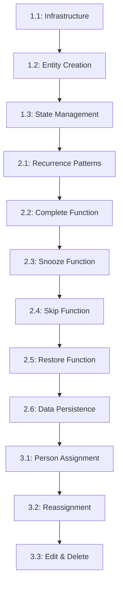

# HASS sh-chore-tracker - User Stories

This directory contains detailed user stories extracted from the [Product Requirements Document (PRD)](../prd.md). Each story includes comprehensive acceptance criteria, technical implementation details, and cross-references to related stories.

## 📊 Project Overview

**Total Stories**: 12 stories across 3 epics
**Completed**: 9 stories (75% complete)
**Planned**: 3 stories (Epic 3)

## 📁 Epic Structure

### [Epic 1: Integration Foundation](epic-1/) - ✅ **COMPLETE**

_Establish the core HASS integration architecture and basic chore entity functionality._

| Story ID                                                    | Name                             | Status      | Effort | Description                            |
| ----------------------------------------------------------- | -------------------------------- | ----------- | ------ | -------------------------------------- |
| [1.1](epic-1/story-1.1-integration-infrastructure-setup.md) | Integration Infrastructure Setup | ✅ Complete | 3 pts  | HASS integration setup and config flow |
| [1.2](epic-1/story-1.2-basic-chore-entity-creation.md)      | Basic Chore Entity Creation      | ✅ Complete | 5 pts  | Core chore entity implementation       |
| [1.3](epic-1/story-1.3-entity-state-management.md)          | Entity State Management          | ✅ Complete | 4 pts  | Rich entity attributes and state logic |

**Epic 1 Total**: 12 story points | **Status**: Foundation established ✅

---

### [Epic 2: Advanced Chore Lifecycle Management](epic-2/) - ✅ **COMPLETE**

_Implement comprehensive chore workflow including advanced recurrence patterns, completion actions, and state persistence._

| Story ID                                                | Name                         | Status      | Effort | Description                              |
| ------------------------------------------------------- | ---------------------------- | ----------- | ------ | ---------------------------------------- |
| [2.1](epic-2/story-2.1-flexible-recurrence-patterns.md) | Flexible Recurrence Patterns | ✅ Complete | 8 pts  | 4 recurrence types with RecurrenceEngine |
| [2.2](epic-2/story-2.2-mark-complete-functionality.md)  | Mark Complete Functionality  | ✅ Complete | 5 pts  | Complete service with state transitions  |
| [2.3](epic-2/story-2.3-snooze-functionality.md)         | Snooze Functionality         | ✅ Complete | 4 pts  | Postpone chores with configurable timing |
| [2.4](epic-2/story-2.4-skip-instance-functionality.md)  | Skip Instance Functionality  | ✅ Complete | 4 pts  | Skip current instance, maintain schedule |
| [2.5](epic-2/story-2.5-restore-functionality.md)        | Restore Functionality        | ✅ Complete | 3 pts  | Restore mistakenly skipped chores        |
| [2.6](epic-2/story-2.6-data-persistence.md)             | Data Persistence             | ✅ Complete | 5 pts  | State persistence across HASS restarts   |

**Epic 2 Total**: 29 story points | **Status**: Core functionality complete ✅

---

### [Epic 3: Person Assignment & Advanced Features](epic-3/) - 🎯 **PLANNED**

_Enable person assignments using HASS Person entities and provide enhanced chore management capabilities._

| Story ID                                                 | Name                          | Status     | Effort | Description                       |
| -------------------------------------------------------- | ----------------------------- | ---------- | ------ | --------------------------------- |
| [3.1](epic-3/story-3.1-person-assignment-integration.md) | Person Assignment Integration | 🎯 Planned | 6 pts  | HASS Person entity integration    |
| [3.2](epic-3/story-3.2-chore-reassignment.md)            | Chore Reassignment            | 🎯 Planned | 4 pts  | Dynamic person assignment changes |
| [3.3](epic-3/story-3.3-chore-edit-and-delete.md)         | Chore Edit and Delete         | 🎯 Planned | 5 pts  | Chore lifecycle management        |

**Epic 3 Total**: 15 story points | **Status**: Ready for implementation 🎯

---

## 🏗️ Story Dependencies

## 📈 Progress Tracking

- **Epic 1**: ✅ 100% Complete (12/12 story points)
- **Epic 2**: ✅ 100% Complete (29/29 story points)
- **Epic 3**: 🎯 0% Complete (0/15 story points)
- **Overall**: 🎯 73% Complete (41/56 story points)

## 🔗 Quick Navigation

- **[PRD Overview](../prd.md)** - Complete product requirements
- **[Architecture](../architecture.md)** - Technical architecture details
- **[Implementation Status](../context.md)** - Current development status

## 📝 Story Format

Each user story follows this structure:

- **User Story**: As/Want/So format with clear value proposition
- **Acceptance Criteria**: Testable requirements with completion status
- **Technical Implementation**: Detailed technical approach and decisions
- **Definition of Done**: Completion checklist
- **Related Stories**: Dependency and relationship mapping

## 🔄 Synchronization Directive

This index must be kept synchronized with the user story table in `/docs/prd.md`. When adding, modifying, or completing stories, update both locations.

---

_Last Updated: 2025-10-11_
_Documentation Status: Individual stories extracted and cross-linked_
